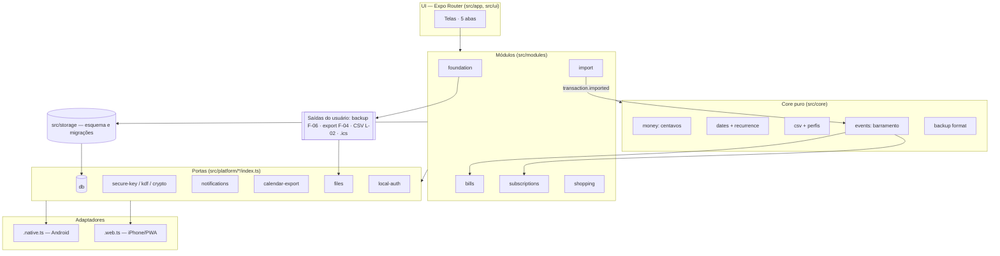

# ARCH.md — Arquitetura · Casa em Dia

> Estado: **v1.0, Fase 2 concluída (28/10/2026)**. Substitui a seção "Arquitetura local-first" do backlog quanto à tecnologia (Capacitor → Expo). Detalhes técnicos em `TRD.md`; decisões em `DECISIONS.md`.

## Visão geral
Monólito modular, um único processo, um único código (Expo SDK 58 + React Native + TypeScript + Expo Router), dois alvos:
- **Android:** app nativo (APK, Android 10+), SQLite + SQLCipher, chave no Keystore, notificações locais.
- **iPhone:** PWA estático (`npx expo export --platform web`, `web.output: "static"`) servido pelo Cloudflare Pages, instalado pelo Safari na Tela de Início (obrigatório, D-002), iOS 18+. O Cloudflare **só serve arquivos**; nenhum dado passa por ele.
- **Zero rede em runtime no MVP** (D-032); nenhuma telemetria; nenhum recurso de terceiros.

## Camadas

| Camada | Pasta | Responsabilidade | Pode depender de |
|---|---|---|---|
| UI (Expo Router) | `src/app` (rotas), `src/ui` (tokens, ~15 componentes próprios, gráficos SVG) | Telas, navegação por 5 abas, acessibilidade. Sem regra de negócio. | modules, core, platform (via interface) |
| Módulos de produto | `src/modules/{foundation,import,bills,subscriptions,shopping}` | Casos de uso por épico, tabelas próprias, reação a eventos | core, storage, platform (via interface) |
| Core puro | `src/core` | Dinheiro (centavos), datas `AAAA-MM-DD` e recorrência, parser de CSV, dedupe, categorização, detecção de assinaturas, mesclagem de listas, formato de backup, barramento de eventos | **nada** além de TS/JS padrão |
| Portas | `src/platform/<cap>/index.ts` | Interfaces: db, secure-key, crypto, kdf, notifications, calendar-export, files, local-auth, lifecycle, screen-security, storage-persistence, barcode, clock, install-state, badge, haptics (TRD §2.1) | — |
| Adaptadores | `src/platform/<cap>/<cap>.native.ts` · `<cap>.web.ts` · `<cap>.fake.ts` | Implementação por plataforma ou degradação explícita (`supported:false`) | libs Expo/RN (native) · APIs web (web) |
| Armazenamento | `src/storage` | Esquema, migrações versionadas, repositórios com SQL puro | platform/db |
| Saídas controladas pelo usuário | foundation + platform/files | Backup criptografado (F-06), exportação (F-04), CSV da lista (L-02), `.ics` (D-001). Únicos caminhos para dados saírem do aparelho | platform/files, calendar-export |

## Diagrama

## Regras de dependência
1. `src/core` não importa nada de `src/app`, `src/ui`, `src/modules`, `src/storage`, `src/platform`, `react*` ou `expo*`.
2. Só `src/platform/**` importa módulos nativos/Expo de plataforma ou APIs web específicas.
3. Módulos não importam outros módulos; comunicam-se por eventos.
4. Capacidade ausente numa plataforma = adaptador com **degradação explícita** + linha em `docs/matriz-paridade.md`.
5. (Sprint 1) Garantir 1–3 por teste automatizado de fronteira.

## Capacidade x Android x iPhone/PWA — **resumo final**
Versão completa por PBI em `docs/matriz-paridade.md`.

| Capacidade | Android | iPhone (PWA) |
|---|---|---|
| Banco | SQLite nativo + **SQLCipher** | SQLite WASM + OPFS + cifra na aplicação (**E-02**) |
| Chave | Keystore | Derivada do PIN (KDF **E-02**), só em memória |
| Bloqueio | PIN 6 + biometria | PIN 6 (passkey: R2 se o E-02 aprovar) |
| Print/Recentes | Bloqueados por padrão | ✕ (modo privacidade) |
| Lembretes | Notificações locais, janela de 60 dias, ações | ✕ notificação → faixa no app + badge (?) + **`.ics`** |
| Receber arquivo | "Abrir com" + seletor | Só seletor |
| Compartilhar arquivo | Compartilhar nativo | Web Share (?) / download |
| CSV grande | Fatias no JS (sem Web Worker) | Web Worker |
| Código de barras | `expo-camera` | EAN digitado (spike testa câmera) |
| Offline | Sempre | Service worker (Sprint 2) |
| Persistência | Garantida | Pode ser despejada → instalação obrigatória + `persist()` + backup semanal |
| Atualização | APK enviado pelo Kaynan | Automática com aviso de nova versão |
| Vibração | Sim | ✕ |
