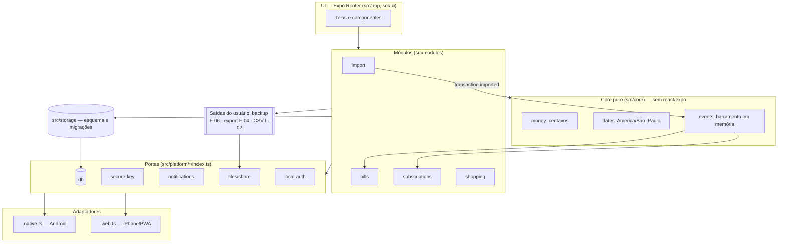

# ARCH.md — Arquitetura

> Estado: **RASCUNHO (Fase 1 — Setup)**. Substitui a seção "Arquitetura local-first" do backlog no que diz respeito à tecnologia (Capacitor → Expo). Os princípios do backlog continuam valendo.

## Visão geral
Monólito modular, um único processo, um único código (Expo + React Native + TypeScript + Expo Router), dois alvos:
- **Android:** binário nativo (development build / APK).
- **iPhone:** PWA estático gerado por `npx expo export --platform web` (`web.output: "static"`), servido pelo Cloudflare Pages. O Cloudflare **só serve arquivos**; não recebe nem guarda dados.

## Camadas

| Camada | Pasta | Responsabilidade | Pode depender de |
|---|---|---|---|
| UI (Expo Router) | `src/app`, `src/ui` | Telas, navegação, componentes. Sem regra de negócio. | modules, core, platform (via interface) |
| Módulos de produto | `src/modules/{import,bills,subscriptions,shopping}` | Casos de uso por épico, tabelas próprias, reação a eventos. | core, storage, platform (via interface) |
| Core puro | `src/core` | Regras de negócio: dinheiro (centavos), datas (America/Sao_Paulo), recorrência, parsing, dedupe, categorização, barramento de eventos em memória. | **nada** além de TS/JS padrão |
| Portas de plataforma | `src/platform/<cap>/index.ts` | Interfaces: chave segura, banco, notificações, arquivos/compartilhar, biometria, câmera, ciclo de vida. | — |
| Adaptadores | `src/platform/<cap>/<cap>.native.ts` · `<cap>.web.ts` | Implementações por plataforma (Metro resolve a extensão). | libs Expo/RN (native) · APIs web (web) |
| Armazenamento | `src/storage` | Esquema, migrações versionadas, repositórios. | platform (porta de banco) |
| Saídas controladas pelo usuário | (módulos + platform) | Backup criptografado (F-06), exportação (F-04), CSV da lista (L-02). Únicos caminhos para dados saírem do aparelho. | platform (arquivos/compartilhar) |

## Diagrama

## Regras de dependência
1. `src/core` não importa nada de `src/app`, `src/ui`, `src/modules`, `src/storage`, `src/platform`, `react*` ou `expo*`.
2. Só `src/platform/**` importa módulos nativos/Expo de plataforma ou APIs web específicas.
3. Módulos não importam outros módulos; comunicam-se por eventos.
4. (A fazer) Garantir as regras 1–3 por lint/teste automatizado.

## Capacidade x Android x iPhone/PWA — **RASCUNHO**
> Nada aqui foi verificado ainda na documentação atual. Cada célula será confirmada na Descoberta antes de virar decisão. Versão viva em `docs/matriz-paridade.md`.

| Capacidade | PBIs | Android (nativo) | iPhone (PWA) | Status |
|---|---|---|---|---|
| Banco local persistente | F-03, todos | SQLite nativo | Armazenamento do navegador (IndexedDB/OPFS + SQLite WASM?) — risco de limpeza pelo Safari | A verificar |
| Criptografia do banco | F-03 | SQLCipher | Sem SQLCipher; criptografia na aplicação (WebCrypto)? | A verificar |
| Chave protegida por hardware | F-01, F-03 | Android Keystore | Sem Keystore; chave derivada do PIN? WebAuthn? | A verificar |
| Biometria / PIN | F-01 | Biometria do sistema + PIN | PIN do app; biometria via WebAuthn incerta | A verificar |
| Ocultar em recentes / bloquear print | F-01 | Possível (flag de janela) | Não disponível na web | Provável degradação |
| Notificação local agendada (app fechado) | A-03, A-04, S-04, F-06 | Sim (alarmes exatos, canais) | Provavelmente **não** sem servidor de push | Provável degradação |
| Ações na notificação | A-05, S-04 | Sim | Depende do item acima | A verificar |
| Reagendar após reboot | A-04 | Sim (a confirmar na lib) | N/A | A verificar |
| Abrir arquivo / seletor | C-01, F-06, L-08 | Seletor do sistema | `<input type=file>` | A verificar |
| "Abrir com" (receber arquivo de outro app) | L-08 | Intent filter | Provavelmente não suportado | Provável degradação |
| Compartilhar arquivo (share sheet) | F-04, F-06, L-02 | Share nativo | Web Share API com arquivos (?) / download | A verificar |
| Processar CSV grande sem travar | C-01 | Sem Web Worker no RN; alternativa a definir | Web Worker | A verificar |
| Câmera: EAN / QR | L-03, L-07 | Câmera nativa | getUserMedia + decodificação em JS | A verificar |
| Consulta SEFAZ (NFC-e) | L-07 (R3) | HTTP direto | Bloqueio por CORS sem servidor | Provável degradação |
| Funciona offline | todos | Nativo | Service worker (não gerado pelo Expo por padrão) | A verificar |
| Atualização do app | C-02 perfis | Novo APK (manual) | Novo deploy no Cloudflare Pages | A definir |
| Backup do sistema desligado | F-03 | `allowBackup=false` | N/A | A verificar |
