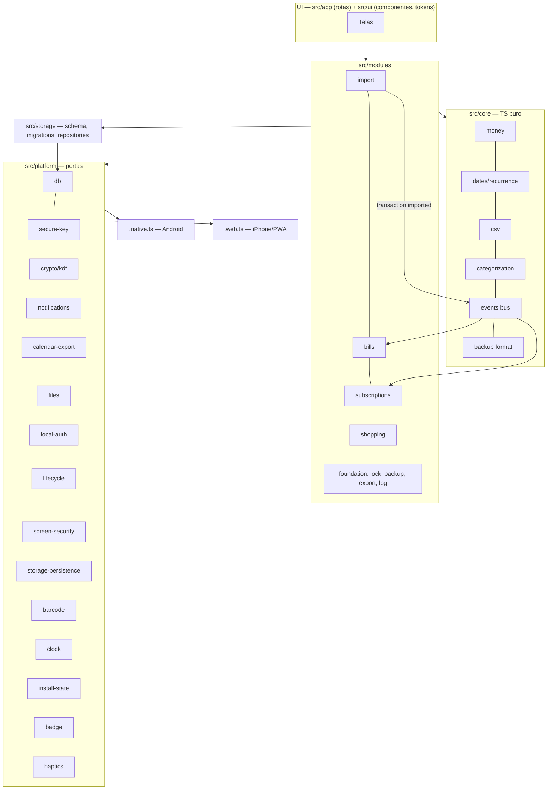

# TRD — Technical Requirements Document · Casa em Dia

> Versão 1.0 · 28/10/2026 · Fase 2 concluída. Decisões referenciadas como D-xxx/ADR-xxx em `DECISIONS.md`.
> Itens **PROVISÓRIOS** dependem do spike **E-02 (Fase 3)** e estão marcados.

## 0. Ambiente e aparelhos de teste (registrado em 27/10/2026, Fase 1 — Verificação)

### Aparelhos
| Plataforma | Aparelho | Versão do SO | Observação |
|---|---|---|---|
| Android (real, principal) | **OPPO CPH2699** (lido via `adb shell getprop`), ABI arm64-v8a | **Android 16 (API 36)**, ColorOS V16.0.0, build CPH2699_16.0.5.1200(EX01) | ColorOS é conhecida por matar processos em segundo plano: aparelho prioritário para testar A-03/A-04. Não tem a opção "Instalar via USB"; a instalação por `adb` pode pedir confirmação na tela. |
| Android (outros) | ≥ 1 aparelho de **outro fabricante** (amigos) | ≥ Android 10 | Obrigatório para o critério de 14 dias (D-012) e para F-06 (restaurar em outro aparelho). |
| Android (emulador) | AVD `Medium_Phone_API_37.0` (x86_64) | Android API 37 | Só desenvolvimento; não substitui o aparelho real. |
| iPhone (teste e amigos) | modelos a informar | **iOS 26.x e iOS 18.x** | PWA pelo Safari; mínimo iOS 18 (D-040). O "iOS 16.4+" do SDK 58 vale só para app nativo. |

### Máquina de desenvolvimento
Ver `docs/PROVA-DE-VIDA.md` (Node 24, JDK 17, Android SDK, **CMake 4.1.2**, wrangler).

### Estratégia de build Android
Build **local** (`npx expo prebuild -p android` + `gradlew`), sem conta Expo (ADR-004). **Expo Go não é usado.**

## Rastreabilidade PBI → TRD
| PBI | Seções |
|---|---|
| F-01 Bloqueio | §2.1 (`local-auth`, `secure-key`, `kdf`, `screen-security`), §3.1 (`lock_state`), §4 |
| F-03 Criptografia | §1, §2.1 (`db`, `secure-key`), §4, §8 (`useSQLCipher`, `allowBackup`) |
| F-04 Exportar/apagar | §2.1 (`files`), §4.2 |
| F-05 Log | §3.1 (`event_log`) |
| F-06 Backup | §2.1 (`crypto`, `kdf`, `files`), §10, §10.1 |
| F-07 Núcleo | §1, §2, §7 (golden files), §10 |
| F-08 Onboarding e ajuda | §2.1 (`install-state`, `local-auth`), §9 (manifest, detecção de instalação) |
| C-01..C-06 | §3.2, §6, §7 |
| A-01, A-03..A-05 | §3.3, §5 |
| S-01..S-04 | §3.4, §5.1 |
| L-01..L-05, L-08 | §3.5, §10 (CSV da lista) |
| PWA / iPhone | §2.1 (`install-state`, `storage-persistence`, `calendar-export`), §5.2, §9 |

## 1. Stack
| Camada | Escolha | Decisão |
|---|---|---|
| App | Expo **SDK 58**, React Native 0.88, React 19.3, TypeScript 6, **Expo Router** (rotas em `src/app`) | ADR-001 |
| Alvos | Android nativo (APK, **Android 10+**) e PWA estático (`web.output: "static"`, **iOS 18+**) | D-005, D-040 |
| Estado | Sem lib: SQLite como fonte da verdade + repositórios + eventos; React Context só para sessão | D-037 |
| Banco | `expo-sqlite`: nativo com **SQLCipher** (`useSQLCipher`); web WASM + OPFS | D-004 |
| Acesso a dados | **SQL puro** + repositórios tipados + migrações próprias | D-037 |
| Criptografia | **AES-256-GCM via `expo-crypto`** (Android + web); **KDF: PROVISÓRIA (E-02)** | D-039 |
| Datas/recorrência | Implementação própria em `src/core` (`AAAA-MM-DD`) | D-038 |
| CSV | Parser próprio em `src/core` | D-038 |
| UI | StyleSheet + tokens + ~15 componentes próprios | D-026 |
| Gráficos | Próprios sobre **react-native-svg** | D-021 |
| Notificações (Android) | Lib Expo de notificações locais (verificar a doc atual no Sprint 5) | — |
| Câmera/EAN (Android) | `expo-camera` (EAN-13 documentado) | D-033 |
| Testes | Jest 30 + `jest-expo` (instalado); RNTL quando houver UI; **Playwright + axe** no sprint do PWA | ADR-008, D-042 |
| CI | GitHub Actions (sem deploy) | D-042 |
| Hospedagem web | Cloudflare **Pages clássico** (`casa-em-dia-44l.pages.dev`), Direct Upload via wrangler | ADR-006 |

Regra para dependência nova: justificar (bundle web e nativo, manutenção, licença compatível com GPL-3.0, suporte a Android **e** web) e avisar (AGENTS.md §9). Dependências futuras previstas: `react-native-svg`, `expo-camera`, lib de notificações, lib de autenticação local/secure store (Android), possivelmente lib de KDF (E-02), `@testing-library/react-native`, Playwright, `@axe-core/playwright`.

## 2. Arquitetura
Monólito modular num único processo. Detalhes e regras de dependência em `ARCH.md`.



### 2.1 Portas de plataforma e adaptadores
| Porta | Contrato (resumo) | Android (`.native.ts`) | iPhone/PWA (`.web.ts`) |
|---|---|---|---|
| `db` | abrir com chave, executar, transação | expo-sqlite + SQLCipher (`cipher_version` + `PRAGMA key`) | expo-sqlite WASM/OPFS + estratégia E-02 (**provisória**) |
| `secure-key` | gerar/obter/apagar chave do banco | Keystore via lib (verificar no Sprint 1; exigir autenticação para liberar) | chave derivada do PIN, só em memória (`extractable: false`) |
| `crypto` | AES-GCM, random, UUID, digest | `expo-crypto` | `expo-crypto` |
| `kdf` | derivar chave de PIN/senha com parâmetros | **E-02** | **E-02** (WebCrypto PBKDF2 ou equivalente) |
| `notifications` | agendar/cancelar/listar por id determinístico; permissões; canais | lib de notificações locais | `supported:false` → degradação (faixa + `.ics`) |
| `calendar-export` | gerar `.ics` | disponível (opcional) | **principal canal de alarme** (D-001) |
| `files` | escolher, salvar, compartilhar, receber "Abrir com" | seletor/Compartilhar nativo, intent | `<input type=file>`, Web Share (arquivos) ou download; sem "Abrir com" |
| `local-auth` | biometria disponível/autenticar | biometria do sistema | `supported:false` (passkey: R2 se E-02 aprovar) |
| `lifecycle` | foreground/background, boot | AppState + reagendar no boot (verificar lib) | `visibilitychange` |
| `screen-security` | bloquear print/Recentes | flag de janela (verificar lib) | `supported:false` |
| `storage-persistence` | persist/estimate | N/A (sempre persistente) | `navigator.storage.persist()/estimate()` |
| `barcode` | ler EAN-13 | `expo-camera` | entrada manual (spike testa `expo-camera` web) |
| `clock` | `now()` | `Date` | `Date` (fake nos testes) |
| `install-state` | está instalado? | sempre sim | `display-mode: standalone` / `navigator.standalone` |
| `badge` | número no ícone | (opcional) | Badging API se suportada (testar) |
| `haptics` | vibração leve | sim | `supported:false` |

## 3. Modelo de dados
Convenções: ids **UUID v4 (TEXT)** gerados no aparelho; dinheiro **INTEGER em centavos**; quantidades **INTEGER em milésimos** (`qty_milli`); datas contábeis `TEXT AAAA-MM-DD`; instantes `TEXT ISO-8601 UTC`; `created_at`/`updated_at` em toda tabela; exclusão lógica `deleted_at` onde há mesclagem/desfazer; `PRAGMA foreign_keys=ON`.

### 3.1 Núcleo e fundação
- `schema_migrations(version INTEGER PK, applied_at)`
- `app_settings(key TEXT PK, value TEXT)`: tema, bloqueio, privacidade, mês financeiro, último backup, etc.
- `event_log(id, at, level, type, data_json)`: só inserção; **sem dados financeiros**; rotação de 7 dias / 1 MB (F-05).
- `lock_state(id=1, failed_attempts, locked_until)`: espera crescente persistida.

### 3.2 Importação (C-01..C-06)
- `account(id, name, bank, kind['checking'|'credit_card'], mask_last4, …)`
- `bank_profile(id, bank, version, mapping_json, builtin)`
- `import_batch(id, account_id, profile_id, profile_version, file_sha256, rows_total, rows_imported, rows_duplicate, imported_at, undone_at)`
- `category(id, name, kind['expense'|'income'|'transfer'|'card_payment'|'neutral'], position, archived_at)`
- `txn(id, account_id, batch_id, posted_on, description_raw, description_norm, amount_cents, category_id, category_source['rule'|'dict'|'user'|'none'], txn_kind['regular'|'transfer'|'card_payment'|'installment'|'refund'], installment_no, installment_total, linked_txn_id, dedupe_key UNIQUE, …, deleted_at)`
- `category_rule(id, match_type['exact'|'contains'|'regex_safe'], pattern_norm, category_id, source['user'|'builtin'], priority, …)`
- Dicionário de estabelecimentos: **asset embutido versionado** (não tabela).

### 3.3 Contas (A-01, A-04)
- `bill_template(id, name, amount_cents NULL(variável), category_id, payment_method, note, barcode_line, recurrence_json, start_on, reminder_rules_json, …, deleted_at)`
- `bill_instance(id, template_id, due_on, amount_cents, paid_on, paid_txn_id, snoozed_until, …)`; estado calculado pela data, exceto "paga".
- `notification_schedule(id TEXT PK determinístico, ref_type['bill'|'subscription'|'backup'], ref_id, rule, fire_at, state['scheduled'|'fired'|'cancelled'])`

### 3.4 Assinaturas (S-01..S-04)
- `subscription(id, service, catalog_key, amount_cents, currency['BRL'|'USD'|'EUR'], billing_period['monthly'|'quarterly'|'semiannual'|'annual'], next_charge_on, trial_ends_on, status['active'|'trial'|'paused'|'cancelled'], my_share_type['none'|'amount'|'percent'], my_share_value, payment_method, category_id, cancel_url, access_until, reminder_days, …)`
- `subscription_charge(id, subscription_id, txn_id, charged_on, amount_cents, currency, fx_rate_micros, amount_brl_cents)`
- `suggestion_dismissal(key PK, pattern_hash, dismissed_at)`
- (R2) `subscription_price_history(...)`

### 3.5 Compras (L-01..L-08)
- `shopping_list(id, name, archived_at, updated_at, deleted_at)`
- `list_item(id, list_id, product_id, name, qty_milli, unit, note, aisle, checked, checked_at, position TEXT(chave fracionária), updated_at, deleted_at)`
- `product(id, canonical_name, name_norm, ean, unit_base, category, brand, package_size_milli)`
- `store(id, name, name_norm, chain, city)`
- `shopping_trip(id, list_id, store_id, started_at, ended_at, total_cents, txn_id)`
- `price_observation(id, product_id, store_id, trip_id, price_cents, unit_price_cents, qty_milli, observed_at, source['manual'|'receipt'|'import'], superseded_by)`: só inserção (edição = nova linha + `superseded_by`).
- Catálogos embutidos versionados: unidades, corredores, serviços de assinatura.

## 4. Segurança e ameaças
### 4.1 STRIDE (Android e web)
| | Android | iPhone/PWA |
|---|---|---|
| **S** Acesso por quem tem o celular | PIN + biometria; chave liberada pelo Keystore após autenticação; trava em 1 min | PIN; chave derivada do PIN (KDF lenta); trava em 1 min |
| **T** Adulteração de CSV/backup/APK | Validação estrita; AES-GCM autenticado; APK assinado (`docs/ASSINATURA.md`) | Idem; o site só é servido por HTTPS da Cloudflare |
| **R** Repúdio | `event_log` local só de inserção | Idem |
| **I** Vazamento: aparelho perdido | SQLCipher | Banco cifrado (E-02) |
| **I** Backup em nuvem do sistema | `allowBackup=false` (config plugin) | N/A |
| **I** App malicioso / outro site | Sandbox do app; nada em storage compartilhado | Isolamento por origem; COOP/COEP; nada sensível em `localStorage` |
| **I** Logs/erros/notificações | Sem dados financeiros; `****1234`; notificação só nome/data | Idem; `.ics` só nome/data |
| **I** Prints/Recentes | Bloqueado por padrão | Não bloqueável → modo privacidade |
| **I** Exportações | Aviso "não criptografado" (F-04, L-02, `.ics`) | Idem |
| **D** Arquivo gigante / cota | 10 MB / 50 mil linhas | Idem + `QuotaExceededError` tratado |
| **E** Código injetado | Sem WebView com conteúdo remoto | **CSP restritiva**, sem scripts de terceiros, SW versionado |
| **Força bruta do PIN** | Keystore + espera crescente | KDF lenta + espera crescente persistida (10⁶ combinações: a KDF é a defesa principal) |

### 4.2 Requisitos de segurança
- PIN nunca em texto claro; KDF com sal (E-02); 5 erros → espera crescente.
- `allowBackup="false"` via config plugin (o prebuild gera `true`).
- Apagar tudo remove banco, chaves, notificações, temporários; no web também OPFS, caches e SW (D-035).
- Nenhuma URL externa no bundle; Cloudflare Web Analytics **desligado**; checagem no CI (D-042).
- Checklist `skills/security-review` em todo PBI que toque dados.

## 5. Notificações e alertas
### 5.1 Android
- Notificações locais agendadas; **janela rolante de 60 dias** e limite de pendentes; **id determinístico** (hash de `ref + regra`); reagendar ao abrir, ao alterar dados, ao terminar importação, após reiniciar e após restaurar backup; reagendar é idempotente.
- Permissões: notificações (Android 13+), **alarmes exatos** (Android 12+; sem permissão → inexato + aviso), canais `bills`, `subscriptions`, `backup`; orientação de bateria por fabricante (ColorOS prioritário).
- Regras padrão (D-031): 3 dias antes, 1 dia antes e no dia, às 9h; silêncio 22h–7h; atraso 1×/dia por 3 dias; máx. 5/dia (excedente vira resumo). Conteúdo padrão: só nome e data.
- Ações (A-05): "Paguei", "Lembrar amanhã"; o app confere o estado no banco antes de aplicar.
- Tela "Meus alertas estão funcionando?" com checklist e "notificação de teste em 1 minuto".
- Lembrete de backup: dia 1, 20h (D-029).

### 5.2 iPhone (PWA) — D-001
- **Não há notificação local** (Web Push exige servidor; fora de escopo).
- Ao abrir o app: faixa "Precisa de atenção" (vencidas, vencendo, renovações, backup atrasado), com ações (Paguei, Adiar). Badge no ícone se a Badging API funcionar (testar).
- "Enviar para o Calendário": `.ics` com um `VEVENT` por vencimento dos próximos 60 dias e `VALARM` conforme as regras; UID determinístico (reexportar atualiza em vez de duplicar, **testar**); conteúdo só nome/data; aviso "não criptografado". **PROVISÓRIO até testar a importação de alarmes no iPhone (E-02).**
- Tela "Lembretes no iPhone" explica o modelo e mostra a data do último `.ics`.

### 5.3 Testes
Relógio simulado e mudança de fuso; reagendar 2× = mesmo conjunto; 14 dias em 2 fabricantes; `.ics` importado no iOS 18 e 26.

## 6. Desempenho (D-041)
| Métrica | Meta | Onde medir |
|---|---|---|
| Abrir até a tela de PIN (frio) | ≤ 2 s | OPPO, iPhone |
| Início/Dashboard com ~10 mil transações | ≤ 2 s | OPPO, iPhone |
| Importar 10 MB / 50 mil linhas | UI responsiva, progresso, ≤ 60 s | OPPO, iPhone |
| Backup/restauração ~10 mil transações | ≤ 10 s (KDF ≈ 1–2 s) | OPPO, iPhone |
| Marcar item comprado | ≤ 100 ms | OPPO, iPhone |
| PWA 1ª carga (4G) | ≤ 5 s; JS inicial ≤ 1,5 MB | iPhone |
Técnicas: índices em `txn(posted_on)`, `txn(category_id, posted_on)`, `txn(dedupe_key)`; agregações em SQL; parsing em blocos (Web Worker no web, fatias no nativo); listas virtualizadas.

## 7. Testes
Pirâmide da skill `testing-strategy`: unit em `src/core` (maioria) · golden files de CSV anonimizados (D-036) · contrato de portas com fakes · integração SQLite (nativo em aparelho; web com Playwright) · backup ida e volta + vetores fixos cruzados · relógio simulado/fusos · e2e web (Playwright + axe, sprint do PWA) · roteiro manual por sprint (TalkBack/VoiceOver, 2 fabricantes Android, iPhone 18/26). CI: `tsc`, `jest`, `expo-doctor`, export web, "sem URL externa" (D-042).

## 8. Build Android
- `npx expo prebuild -p android` (pasta `android/` gerada, fora do git) + `gradlew`.
- **CMake 4.1.2** obrigatório no Windows (MAX_PATH); `cmake.dir` precisa virar **configuração reproduzível** (config plugin ou variável de ambiente; tarefa do Sprint 1).
- Config plugins a criar/usar: `allowBackup=false`, `useSQLCipher: true`, permissões de notificação/alarme, intent filter de `.csv` ("Abrir com", L-08/C-01), flag de segurança de janela (se a lib exigir).
- Debug: ABI `arm64-v8a`. Release: `arm64-v8a` + `armeabi-v7a` (aparelhos Android 10 de 32 bits), JS embutido, assinado com a keystore do Kaynan (`docs/ASSINATURA.md`), `versionCode` incremental e `version` semver exibida no app (D-007).
- Package: `com.kaynansouza.financasecasa` (imutável; D/ADR-005).

## 9. Build web e deploy no Cloudflare Pages
- `npx expo export --platform web` → `dist/`; validar com `npx wrangler pages dev dist`.
- Preview: `npx wrangler pages deploy dist --project-name casa-em-dia --branch <branch>` (avisar). **Produção (`--branch main`) só com comando explícito.** Login sempre do Kaynan. Ver `docs/DEPLOY-CLOUDFLARE.md`. Decidir Pages clássico × Workers antes da produção (ADR-006).
- **PWA (Sprint 2):** `manifest.webmanifest` (nome, `short_name`, `display: standalone`, cores, ícones 192/512/maskable, `apple-touch-icon` 180), meta tags do iOS e `viewport-fit=cover`; detecção de instalação (bloqueio até instalar, D-002).
- **Service worker:** pré-cache do shell (HTML, `/_expo/static/**`, `.wasm`, ícones); nome do cache = hash do build; cache-first para assets com hash, network-first com fallback para HTML; nova versão fica em `waiting` → faixa "Nova versão disponível" → `SKIP_WAITING` só com o toque do usuário; nunca cachear dados. Implementação (SW próprio gerado no build × Workbox) decidida no Sprint 2 com justificativa.
- **`_headers` final (a validar no preview do Sprint 2):**
  ```
  /*
    Content-Security-Policy: default-src 'self'; connect-src 'self'; img-src 'self' data: blob:; worker-src 'self' blob:; script-src 'self' 'wasm-unsafe-eval'; style-src 'self' 'unsafe-inline'; font-src 'self'; manifest-src 'self'; frame-ancestors 'none'; base-uri 'self'; form-action 'self'
    Cross-Origin-Opener-Policy: same-origin
    Cross-Origin-Embedder-Policy: credentialless
    X-Content-Type-Options: nosniff
    Referrer-Policy: no-referrer
    Permissions-Policy: camera=(), microphone=(), geolocation=(), payment=(), usb=()
  /_expo/static/*
    Cache-Control: public, max-age=31536000, immutable
  /sw.js
    Cache-Control: no-cache
  /manifest.webmanifest
    Cache-Control: no-cache
  ```
  (Ajustar `script-src`/`style-src` só com evidência do que o export do Expo exige; `camera=(self)` apenas se o spike liberar câmera no iPhone.)
- `_redirects` sem regras (ADR-007).

## 10. Versionamento de esquema e de formatos
| Artefato | Versão | Regra |
|---|---|---|
| Esquema SQLite | `schema_migrations.version` (inteiro) | Migração por versão, em transação; nunca editar migração publicada |
| Backup F-06 | `formatVer` (uint16) + `schemaVersion` no cabeçalho | Restaurar aceita `schemaVersion` ≤ atual (migra) e recusa > atual ("atualize o app"); 1 vetor fixo sintético por `formatVer` em `tests/fixtures/backup/` |
| CSV da lista (L-02) | Coluna `format_version` (começa em `1`) | Importação recusa versão desconhecida com mensagem amigável |
| `.ics` | UID determinístico por instância + `SEQUENCE` | Reexportar atualiza eventos (testar no iOS) |
| Perfis de banco | `bank_profile.version` | Guardado no `import_batch` para reprocessar/desfazer |
| Dicionários/catálogos | versão do asset | Atualizam com a versão do app |
| App | semver em `app.json` + `versionCode` (Android) | Exibido em Configurações/Diagnóstico |
| Service worker | hash do build | Aviso de nova versão |

### 10.1 Formato do backup (rascunho; fechar no Sprint 2 após E-02)
`"CEDBKP"` + `formatVer` + `headerLen` + header JSON (KDF e parâmetros, `AES-256-GCM`, IV, `schemaVersion`, `createdAt`, `appVersion`, `platform`), autenticado como AAD + ciphertext de um **dump lógico neutro** comprimido (nunca o `.db` cru). Chaves e PIN nunca entram. Detalhes na skill `backup-cross-platform`.
